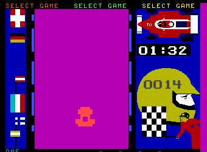
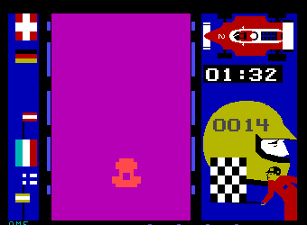
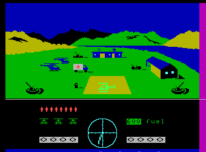
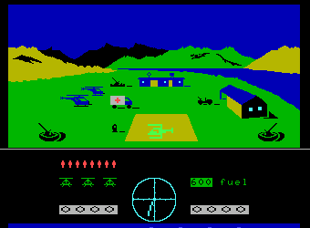
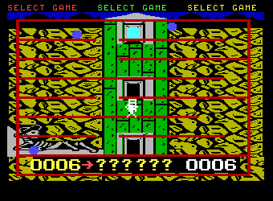
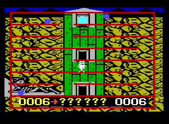
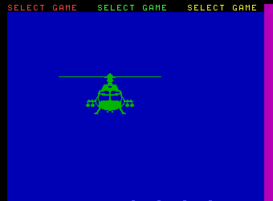
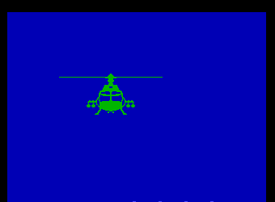

# Videopac+ correction: validation and integration status

## Scope and branch dependencies

The rendering change was approved as commit
`2d0eb3e63b2e417271d9b3ab2ced77a309d92402`, after C7010 support (`81a31ea`)
and the Region Auto correction (`36bf5e3`). The complete approved source is
available on [integration/c7010-videopacplus-approved](https://github.com/bengtovepeltz-design/libretro-o2em/tree/integration/c7010-videopacplus-approved).

The separate `fix/videopacplus-upstream` PR branch cherry-picks only the
rendering change onto upstream `679d6fe`; it does not contain or depend on
C7010 or Region Auto. Its different commit ID reflects the different parent.
Runtime graphics changes match the approved patch. Documentation, attribution
and evidence are additional publication-only commits. The standalone branch
has not been separately built; Windows tests below used the complete approved
integration. No approved executable was rebuilt or replaced for publication.

The C7010 PR #73 is updated separately with `36bf5e3`: ordinary Auto once again
follows the console BIOS rather than filename prefixes. C7010 Auto remains
PAL. No Videopac+ change is included in that PR.

## Technical explanation

The cached EF934x layer retained old pixels when a display window became
disabled/concealed. Rebuilding the layer from black makes the display control
registers effective, including disabling the service row. This removes stale
SELECT GAME without identifying or masking any text.

The 320-pixel character window was composed into a wider output surface, but
the missing border samples did not pass through the mixer. They now supply
the EF934x black output to O2EM's existing VDC-color transparency decoder.
Opaque VDC pixels remain visible. No crop, palette substitution, shader,
game-specific workaround, or arbitrary framebuffer mask is used.

## Completed Windows validation

The final Windows x64 DLL was built through the existing GNU Make/MSVC target
with The Voice enabled. The user personally tested and approved the installed
core on 2026-11-16. No ROM, BIOS, firmware or state files are published.

Earlier baseline work: 18 runs compared stock, C7010 and Region Auto builds.
The reported defects already existed in stock. Focused tests cover service-row
disable, 128 color/decoder combinations across active pixels and borders, and
VPP bypass. A real RetroArch run with private settings confirmed the fix.

Final regression: 50 runs, including two ordinary games with Odyssey2/C52
BIOS and Auto/PAL/NTSC, all three target Videopac+ games, original-core and
previous-core state loading, explicit C7010 PAL/NTSC, and the full C7010
five-move sequence over 28,000 frames.

- All 23 paired baseline/candidate cases have identical final machine state
  and captured audio. Nonzero audio samples were checked; this compares the
  host's captured channel, not a new acoustic or audio-device assessment.
- Ordinary-game and C7010 images match their baselines. All six approved
  C7010 framebuffer/state checkpoints match exactly, and an approved older
  C7010 state continues to its expected result.
- Nine matched Videopac+ screenshots (three games at frames 1199/3199/5199)
  have zero changed pixels inside the active artwork below the service row.
  Intentional backgrounds, including Race's central magenta area, remain.
- Controller/no-controller controls affect machine state and audio in all
  three games; Race/Pickaxe also differ in their final image. Helicopter's
  selected final image is unchanged by that particular input sequence.
- Helicopter's HUD is still being drawn at frame 1199 and is complete by
  3199; its early partial drawing was not treated as a separate proven defect.

Machine-readable summaries: [paired comparisons](validation_results/comparisons.json),
[artwork](validation_results/artwork-comparison.json),
[C7010 checkpoints](validation_results/chess-approved-checkpoints.json),
[audio](validation_results/audio-metrics.json),
[input controls](validation_results/input-control-comparison.json).
The four additional paired PAL/NTSC and original-state checks are described
above; the paired-comparisons JSON contains the 19 main pairs.

## Before and after

Each pair below uses identical BIOS, PAL setting and scripted input, captured
at frame 5199. Before is the Region Auto baseline; after is the approved
graphics integration. Images are direct framebuffer exports, not artwork edits.

| Game | Before | After |
| --- | --- | --- |
| Race+Spin+Cryptogram |  |  |
| Helicopter Rescue |  |  |
| Pickaxe Pete+ |  |  |

Helicopter title, matched at frame 599:

| Before | After |
| --- | --- |
|  |  |

## Independent testing and remaining platforms

Thanks to Mike / Retro Vault (@donmiguel-stack) for independent Linux/GCC,
WebAssembly, gameplay and broad compatibility validation of the earlier
published C7010 contribution, and for identifying the Region Auto scope issue.
His [independent report](https://github.com/libretro/libretro-o2em/pull/73#issuecomment-6894905018)
applies to `81a31ea`, not these new corrections. It is not counted as locally
reproduced testing here. The current C7010 PR update provides details.

**Linux and WebAssembly validation of the new Region Auto and Videopac+
changes is pending.** Windows results are a focused local selection, not all
games, levels, BIOS combinations, hardware or architectures. No new general
CPU/Z80, timing, sound or save-format functionality is introduced.

See [source provenance and licensing](VIDEOPAC_PLUS_PROVENANCE.md) for retained
O2EM credits, the MAME reference authors and the file-specific BSD-3-Clause
notices. No MAME source code was imported.
